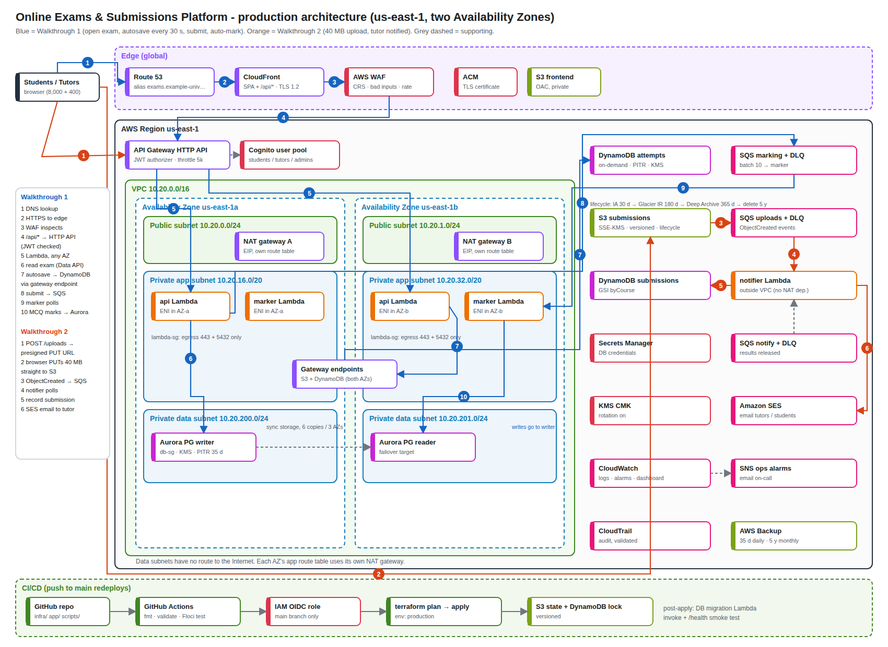

# DSO303 Assignment 2 – Online Exams & Submissions Platform

Cloud architecture for a university with 8,000 students and about 400 staff that is moving all exams and assignment submissions online. It covers role-based sign-in, timed MCQ and short-answer exams with **autosave every 30 s**, MCQ **auto-marking**, **PDF/ZIP uploads up to 50 MB**, and **email when results are released**. It must handle **3,000 students starting one exam within 5 minutes**, reach **99.9% availability**, survive the **loss of one AZ**, meet **RPO ≤ 5 min / RTO ≤ 1 h**, keep **records for 5 years**, and **encrypt in transit and at rest**.



## Summary

| Layer | Services |
|---|---|
| Edge | Route 53 → CloudFront (SPA + `/api/*`) + AWS WAF + ACM; S3 frontend via OAC |
| Auth | Cognito user pool, groups `students` / `tutors` / `admins`, JWT authorizer on API Gateway |
| API and compute | API Gateway HTTP API → Lambda `api` and `marker` in **private app subnets of us-east-1a and us-east-1b**; `notifier` Lambda outside the VPC |
| Data | **Aurora PostgreSQL** (writer AZ-a, reader/failover AZ-b, Data API, 35-day PITR) · **DynamoDB** autosave + submissions (on-demand, PITR) |
| Files | **S3** presigned PUT uploads, SSE-KMS, versioning, lifecycle IA → Glacier IR → Deep Archive → delete at 5 years |
| Async | **SQS** marking / uploads / notify queues with DLQs → Lambda → **SES** email |
| Security | KMS CMK, Secrets Manager, least-privilege IAM per function, SG-to-SG rules, TLS-only bucket policy, CloudTrail |
| Operations | CloudWatch alarms + dashboard → SNS, AWS Backup (35 days daily, 5 years monthly) |
| CI/CD | GitHub Actions: PR checks plus a full Floci integration test; **push to `main` → OIDC → terraform plan/apply → DB migration → smoke test** |

How the design handles the exam peak and the loss of an AZ is explained in [architecture/walkthroughs.md](architecture/walkthroughs.md#how-the-design-handles-the-exam-peak-and-the-loss-of-one-az-300-words).

## Repository layout

```
README.md                  this file
architecture/              diagram.png/.svg (+ make_diagram.py), walkthroughs.md (both walkthroughs, peak + AZ loss)
docs/services.md           service table: role, why over an alternative, configuration, connections
infra/                     Terraform (VPC, edge, auth, API, Lambda, Aurora, DynamoDB, S3, SQS, SES, KMS, monitoring)
  envs/                    prod / floci tfvars + S3 backend configs
  bootstrap/               one-off: prod state bucket, lock table, GitHub OIDC deploy role
app/                       Lambda code (api, marker, notifier, shared Data API helper) + SPA frontend
scripts/                   deploy, destroy, walkthrough 1, walkthrough 2, AZ failure, exam-window pre-warm
lab/                       Cloud Architecture Lab model (reference JSON + generator) and headless simulation runner
evidence/lab/              Cloud Architecture Lab screenshots: both walkthroughs healthy and with AZ-A down
evidence/terminal/         terminal screenshots (+ full logs) of the deployment and simulations
REPORT.pdf / REPORT.html   assembled report
.github/workflows/         ci.yml (checks + Floci integration), deploy.yml (push to main → AWS)
```

## Deploy

### Locally on Floci (the AWS emulator used in this module)

Requirements: Docker with the Floci container on `localhost:4566`, Terraform ≥ 1.6, AWS CLI v2, Node 20, Python 3.

```bash
./scripts/deploy.sh                      # state bucket + lock table, terraform apply, DB migration, /health
./scripts/walkthrough-1-exam-autosave.sh # sign in, open exam, autosave, submit, auto-mark
./scripts/walkthrough-2-upload-notify.sh # 40 MB presigned upload -> S3 event -> SQS -> notifier -> SES
./scripts/az-failure.sh                  # remove AZ-a resources, keep serving, rebuild with terraform
```

`ENV=floci` is the default. On Floci the following are switched off by `envs/floci.tfvars` or `use_floci`, because the emulator does not support them: the CloudFront distribution (its API response crashes the AWS provider; Route 53 gets a CNAME to the API instead), Cognito MFA, CloudWatch dashboards, AWS Backup, CloudTrail, the JWT authorizer (identity is passed as `x-demo-*` headers) and the Lambda alias integration. Floci also reports both Aurora instances in AZ-a and cannot fail a cluster over, so the real AZ simulation is done in the Cloud Architecture Lab.

### Real AWS (production)

```bash
# one-off, as an administrator
terraform -chdir=infra/bootstrap init && terraform -chdir=infra/bootstrap apply -var github_repo=<owner>/<repo>
# set repository variable AWS_DEPLOY_ROLE_ARN to the output, then create a "production" environment

git push origin main                     # .github/workflows/deploy.yml plans, applies, migrates and smoke-tests
# or manually:
ENV=prod ./scripts/deploy.sh
ENV=prod ./scripts/exam-window.sh open 300   # pre-warm before a scheduled exam; "close" afterwards
```

Before the first production deploy: verify the SES sender identity and request SES production access, and validate the ACM certificate through the Route 53 zone.

## Tear down

```bash
./scripts/destroy.sh                          # Floci: destroys all ~113 resources
DELETE_STATE=yes ./scripts/destroy.sh         # also removes the state bucket and lock table
```

Production has **deletion protection** on Aurora and DynamoDB and a final Aurora snapshot by design. To decommission, set `deletion_protection` off in a reviewed change, then run `ENV=prod ./scripts/destroy.sh`. The submissions bucket is not force-destroyed in production, so empty or archive it first (records must be kept for 5 years).

## Cloud Architecture Lab

`python3 lab/build_lab.py` writes `lab/exam-platform.reference.json` plus one variant per walkthrough (the lab starts a request at the reference's start node). Load them through **Reference Diagrams**, press **Send Request**, then **Failure Lab → Simulate AZ-A Outage** and send again. To run the same simulations headlessly:

```bash
LAB_DIR=/path/to/aws-resilience-simulator node --experimental-strip-types lab/simulate.ts
```

Results: 5 of 5 flows pass with both AZs healthy, and 5 of 5 pass with AZ-A down. API Gateway drops the failed AZ-A Lambda and uses AZ-B, and Aurora performs a Multi-AZ failover. Screenshots are in `evidence/lab/`.
