# DSO303 Assignment 2 – Architecture Design and Deployment

## 1. Scenario and requirements

A university with **8,000 students and about 400 staff** is moving all exams and assignment submissions online.

| Requirement | How it is met (details in sections 2–4) |
|---|---|
| Role-based sign-in (student, tutor, admin) | Cognito user pool groups + API Gateway JWT authorizer + per-route group checks |
| Timed MCQ / short-answer exams, autosave every 30 s | `api` Lambda + DynamoDB conditional writes; the exam deadline is enforced server-side |
| Auto-marking of MCQs | SQS marking queue → `marker` Lambda → Aurora `results` |
| PDF/ZIP uploads up to 50 MB | Presigned S3 PUT (size and type signed), never through API/Lambda |
| Email when results are released / new submission | SQS notify/uploads queues → `notifier` Lambda → SES |
| 300–500 concurrent users; 3,000 starting an exam within 5 min | Serverless request path, reserved and provisioned concurrency, on-demand DynamoDB, SQS buffering |
| 99.9% during exams, survive the loss of one AZ | Two AZs for every zonal component; regional managed services; per-AZ NAT |
| RPO ≤ 5 min, RTO ≤ 1 h | Autosave every 30 s + DynamoDB PITR; Aurora synchronous storage + 35-day PITR; Terraform rebuild |
| Records kept 5 years, encryption in transit and at rest | S3 lifecycle to Deep Archive, delete at 5 years; AWS Backup monthly kept 5 years; KMS everywhere; TLS-only |

<div class="page-break"></div>

## 2. Task 1 – Architecture design

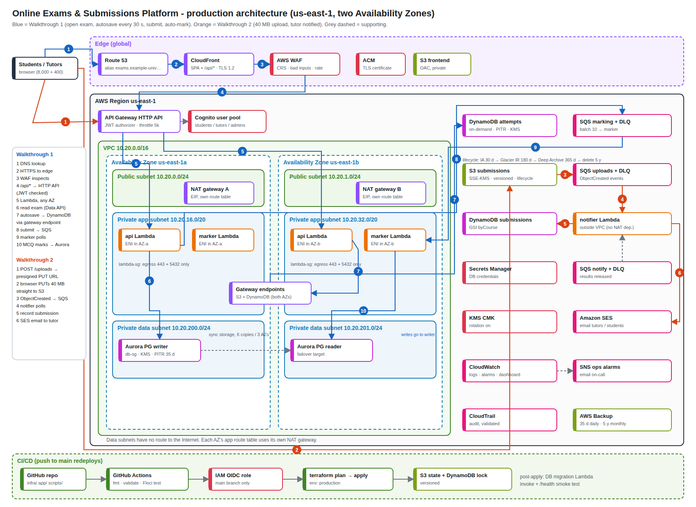
<p class="caption">Figure 1 – Production architecture in us-east-1 across two Availability Zones. Blue numbers = walkthrough 1, orange = walkthrough 2 (source: <code>architecture/diagram.svg</code>).</p>

### 2.1 Components by tier

| Tier | us-east-1a | us-east-1b |
|---|---|---|
| Edge (global) | Route 53 → CloudFront + WAF (+ ACM); S3 frontend via OAC | same (global) |
| Regional managed (multi-AZ by design) | API Gateway HTTP API, Cognito, DynamoDB, S3, SQS, SES, Secrets Manager, KMS, CloudWatch, SNS, CloudTrail, AWS Backup | same |
| Public subnet | `10.20.0.0/24` – NAT gateway A | `10.20.1.0/24` – NAT gateway B |
| Private app subnet | `10.20.16.0/20` – `api` and `marker` Lambda ENIs | `10.20.32.0/20` – `api` and `marker` Lambda ENIs |
| Private data subnet (no Internet route) | `10.20.200.0/24` – Aurora PostgreSQL writer | `10.20.201.0/24` – Aurora reader / failover target |
| Secrets | Secrets Manager (DB credentials), KMS customer key with rotation | |
| CI/CD | GitHub Actions → OIDC role → `terraform plan/apply` (S3 state + DynamoDB lock) → DB migration → smoke test | |

### 2.2 Walkthrough 1 – a student opens an exam and answers autosave

1. **DNS.** The browser resolves `exams.example-university.edu`. Route 53 returns the CloudFront alias.
2. **Edge.** CloudFront serves the SPA from S3. The student has signed in through Cognito and holds a JWT with the `students` group.
3. **WAF.** `GET /api/exams/dso303-midterm` passes the managed rules and the per-IP rate rule.
4. **API.** CloudFront forwards `/api/*` (not cached) to the HTTP API. The JWT authorizer validates the token.
5. **Compute.** API Gateway invokes the `api` Lambda (`live` alias, warm during exam windows) in either AZ.
6. **Read exam.** The Lambda reads the exam and questions from Aurora through the RDS Data API (the answer key is never selected). `POST …/attempts` creates the attempt and deadline.
7. **Autosave every 30 s.** The browser sends `PUT /api/attempts/{id}/answers`. Conditional `UpdateItem` writes go to DynamoDB through the gateway endpoint, and only answers with a newer `clientTs` are accepted, so a late retry cannot overwrite a newer answer.
8. **Submit.** `POST …/submit` marks the attempt `submitted` and queues it on SQS. The student gets `202` straight away.
9. **Mark.** The `marker` Lambda polls batches of 10, compares answers with the key and scores the MCQs.
10. **Result.** It writes the result to the Aurora writer. Short answers are flagged for the tutor. Failures are retried, then moved to a DLQ that raises an alarm.

### 2.3 Walkthrough 2 – a student uploads a 40 MB assignment and the tutor is notified

1. **Request upload.** `POST /api/uploads {courseId, assignmentId, fileName, size}`. The `api` Lambda rejects anything that is not PDF/ZIP or is over 50 MB, then returns a 15-minute presigned PUT URL with the size and content type signed.
2. **Upload.** The browser PUTs the 40 MB file **directly to S3** (API Gateway's 10 MB and Lambda's 6 MB payload limits never apply). S3 stores it SSE-KMS encrypted and versioned under `submissions/…`.
3. **Event.** S3 sends `ObjectCreated` → SQS uploads queue.
4. **Process.** The `notifier` Lambda (outside the VPC, so it has no NAT dependency) polls the queue and runs `HeadObject`.
5. **Record.** It writes the submission to DynamoDB (`byCourse` index) and looks up the tutor in Aurora.
6. **Notify.** It calls SES `SendEmail` to the tutor. The tutor lists submissions through `GET /api/courses/DSO303/submissions`.

### 2.4 How the design handles the exam peak and the loss of one AZ (299 words)

**Exam peak.** 3,000 students opening one exam within 5 minutes is about 10 requests/s on average, with bursts in the first minute. Autosave then adds 3,000 ÷ 30 s ≈ **100 writes/s**. Nothing in the request path needs pre-provisioned servers. CloudFront serves the SPA from the edge, so the API only sees API calls. The HTTP API stage allows a 5,000 burst. The `api` Lambda has **600 reserved concurrency**, so marking can never starve it. `scripts/exam-window.sh` sets **300 provisioned concurrency** before a scheduled exam to remove cold starts. Autosaves go to **on-demand DynamoDB**, not the relational database, and the RDS **Data API** means no database connection pool to exhaust. Submissions are buffered in **SQS**: marking happens at its own pace (reserved concurrency 50) and the student still gets an instant `202`. Uploads bypass the API through presigned S3 URLs. WAF's per-IP limit is high because a whole exam hall shares one campus IP.

**Loss of one AZ.** Every stateful or routed component exists in both zones. Lambda places ENIs in both private app subnets and stops using the failed one. Each AZ has **its own NAT gateway and route table**, and the notifier runs outside the VPC, so no traffic depends on the lost zone. Aurora's storage is replicated six ways across three AZs. If the writer's AZ fails, the reader in us-east-1b is promoted (typically under 60 s) and the cluster endpoint follows it, with no committed data lost. DynamoDB, S3, SQS, API Gateway, Cognito, CloudFront and Route 53 are regional or global services that tolerate an AZ loss. The answer RPO is at most 30 s (autosave interval, PITR), and the database RPO is about 0. The RTO is minutes, and `terraform apply` rebuilds lost AZ resources. Both well inside the 5-minute RPO and 1-hour RTO targets.

## 4. Task 3 – Implementation

The design is implemented three ways:

- **(a)** It is built and simulated in the **Cloud Architecture Lab**.
- **(b)** It is fully coded in **Terraform + Node.js Lambda**, deployed end to end on **Floci**, the local AWS emulator used in this module, where both walkthroughs and an AZ failure are run for real.
- **(c)** A **GitHub Actions** pipeline redeploys on every push to `main`.

All terminal screenshots below are rendered from the captured output of these runs. The complete, unedited logs are in `evidence/terminal/logs/`.

### 4.1 Cloud Architecture Lab – full build

The architecture is generated by `lab/build_lab.py` as a lab reference: 45 services, 15 boundaries, IAM roles and resource ARNs matching Terraform. It is loaded in the lab through **Reference Diagrams**.

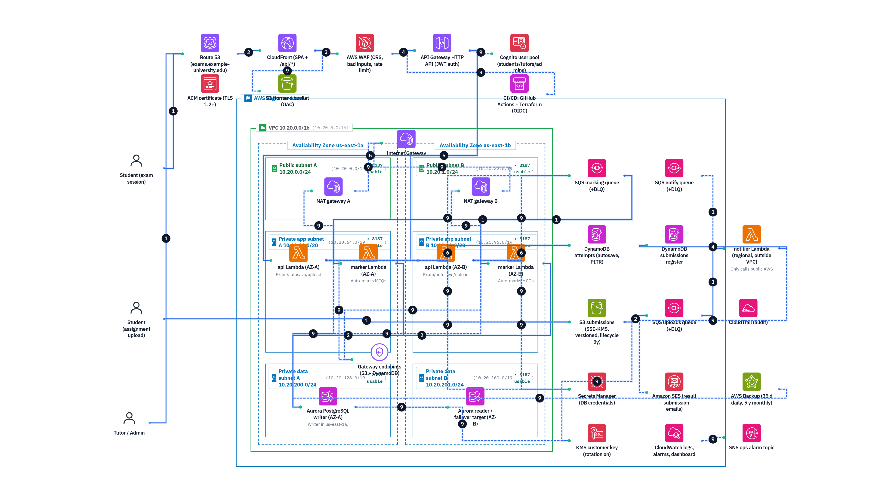
<p class="caption">Figure 2 – The full build exported from the Cloud Architecture Lab ("Download Image"): Region → VPC → two AZ boxes → public / private app / private data subnets per AZ, with the regional services on the right.</p>

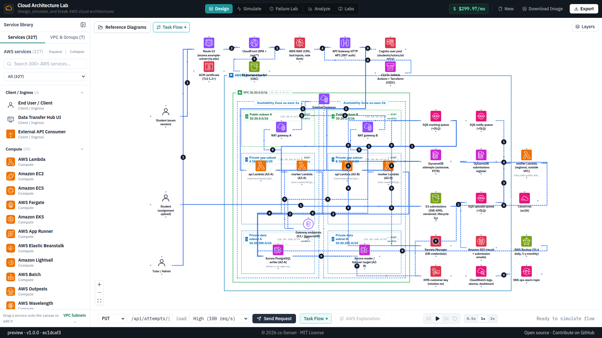
<p class="caption">Figure 3 – The reference loaded on the lab canvas (Simulate view).</p>

### 4.2 Cloud Architecture Lab – walkthroughs (both AZs healthy)

The lab treats an SQS queue as an asynchronous boundary (the producer receives `202` and the trace ends), so each consumer half is sent as its own request.

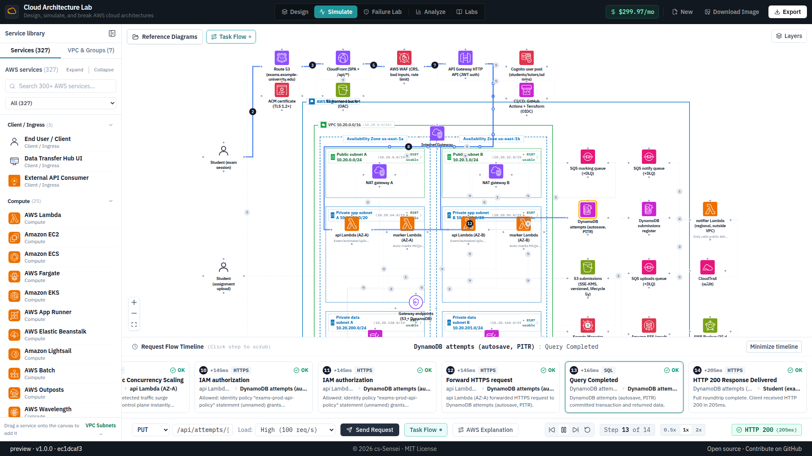
<p class="caption">Figure 4 – Walkthrough 1a: Student → Route 53 → CloudFront → WAF → API Gateway → api Lambda (AZ-A) → DynamoDB. <b>HTTP 200, 205 ms</b>. IAM is evaluated on the Lambda → DynamoDB call.</p>

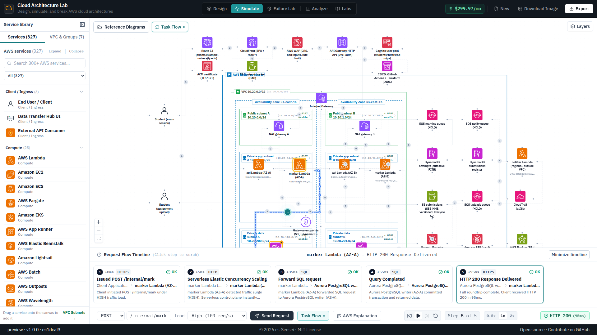
<p class="caption">Figure 5 – Walkthrough 1c: marker Lambda writes the MCQ result to the Aurora writer. <b>HTTP 200</b>.</p>


<p class="caption">Figure 6 – Walkthrough 2a: 40 MB PUT straight to the S3 submissions bucket → ObjectCreated → SQS uploads queue. <b>HTTP 202</b> (accepted for async processing).</p>

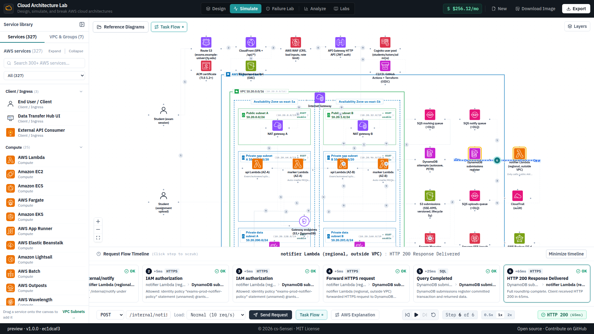
<p class="caption">Figure 7 – Walkthrough 2b: the notifier Lambda records the submission in DynamoDB. <b>HTTP 200</b>. The lab has no Lambda → SES connection contract ("behavior not modeled"), so the SES email is drawn as a dependency in the lab and proven on Floci (Figure 19b).</p>

### 4.3 Cloud Architecture Lab – AZ-A failure

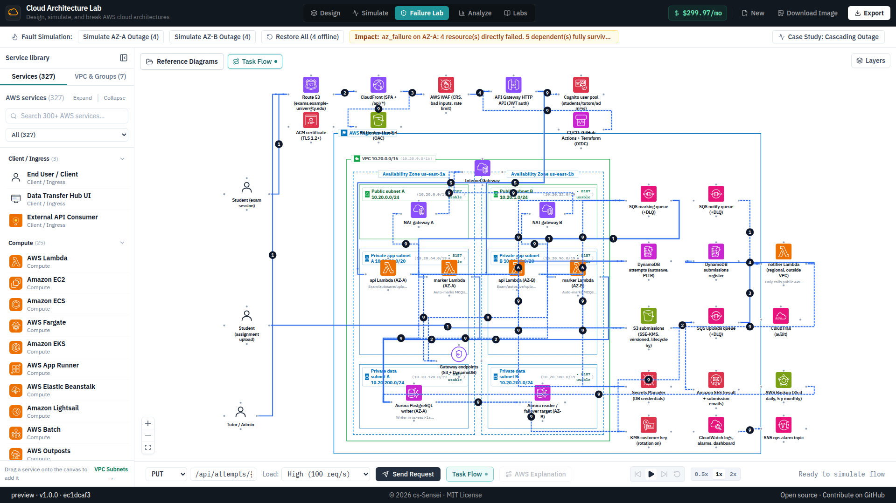
<p class="caption">Figure 8 – Failure Lab → <b>Simulate AZ-A Outage</b>: NAT gateway A, api Lambda (AZ-A), marker Lambda (AZ-A) and the Aurora writer (AZ-A) are failed.</p>

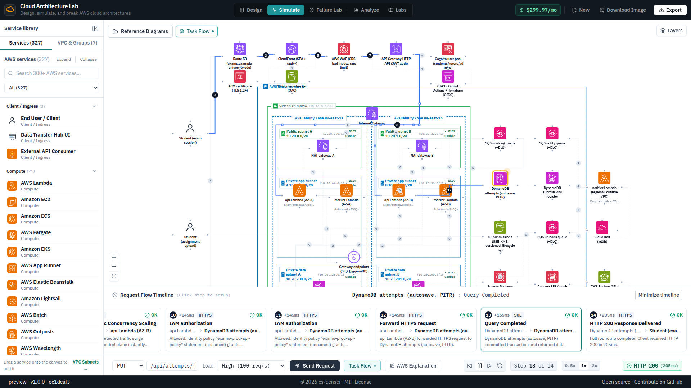
<p class="caption">Figure 9 – Walkthrough 1a during the outage: API Gateway detects the failed AZ-A target and routes to <b>api Lambda (AZ-B)</b>. <b>HTTP 200</b>.</p>

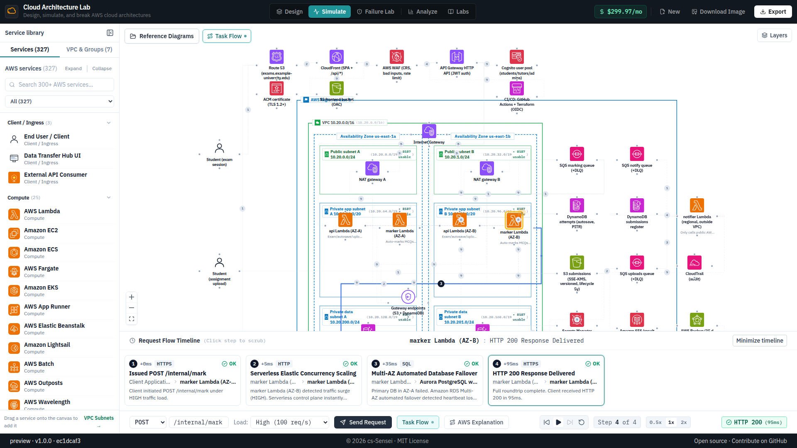
<p class="caption">Figure 10 – Walkthrough 1c during the outage: marker Lambda (AZ-B) → Aurora: <b>"Multi-AZ Automated Database Failover"</b> to the standby in AZ-B. <b>HTTP 200</b>.</p>

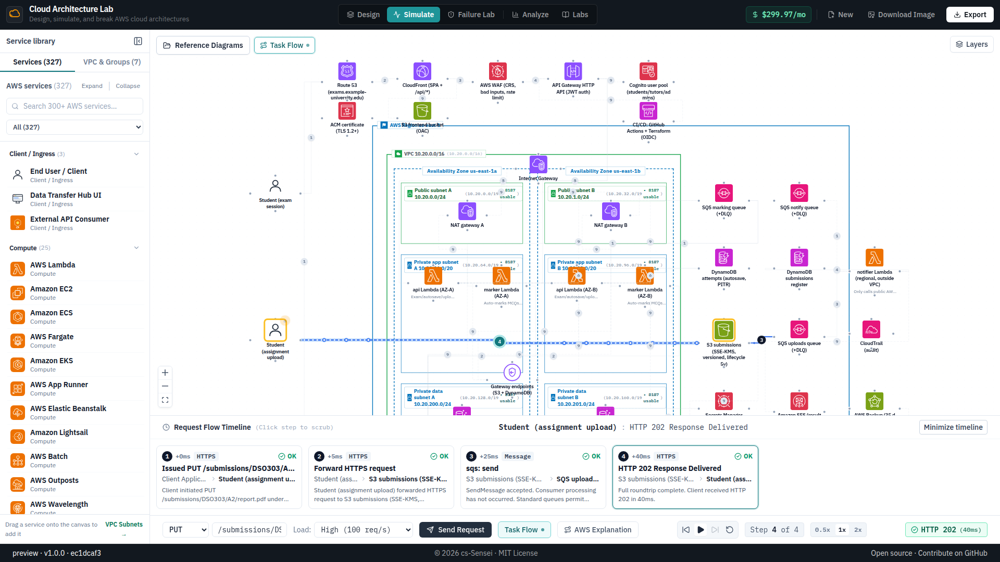
<p class="caption">Figure 11 – Walkthrough 2a during the outage: the upload path is all regional services and is unaffected. <b>HTTP 202</b>.</p>


<p class="caption">Figure 12 – Walkthrough 2b during the outage: the notifier runs outside the VPC with no NAT dependency. <b>HTTP 200</b>.</p>

The same simulations were also run headlessly with the lab's own engine (`lab/simulate.ts`). The result is **5/5 flows pass healthy and 5/5 pass with AZ-A down**:

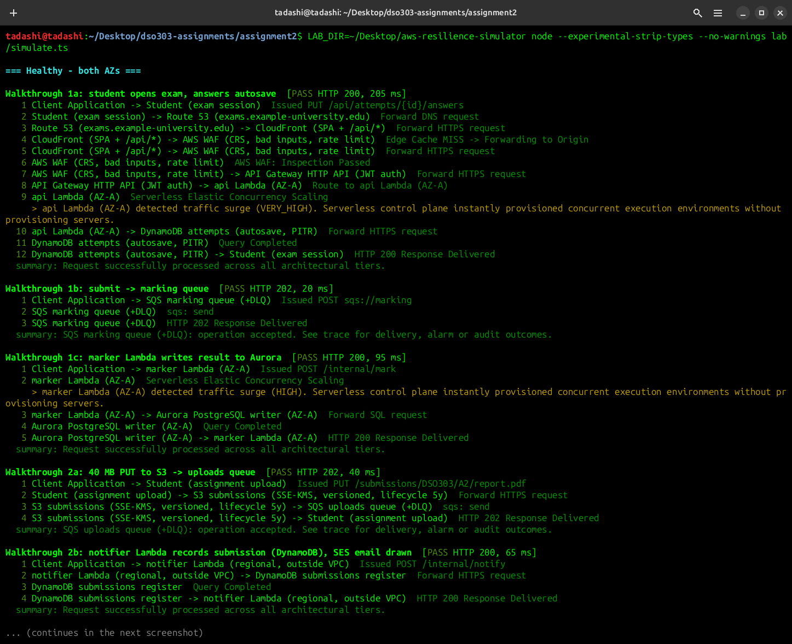
<p class="caption">Figure 13 – Lab engine run from the terminal: all five flows with both AZs healthy.</p>

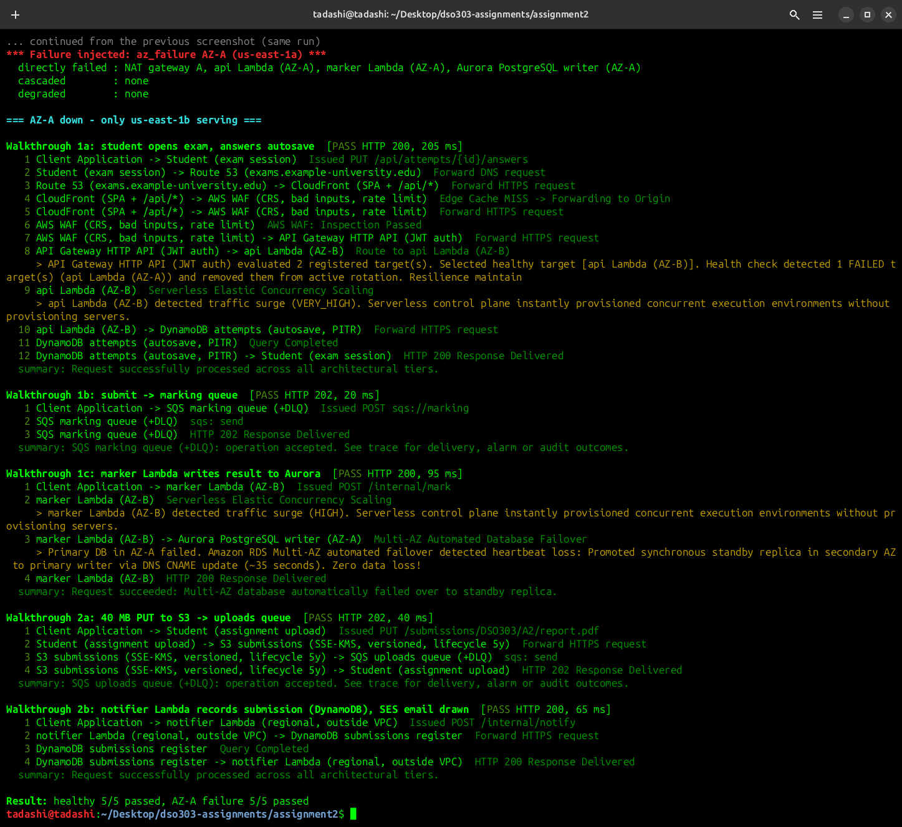
<p class="caption">Figure 14 – Same run continued: az_failure AZ-A injected, then all five flows re-run and pass (failed AZ-A Lambda removed from rotation, Aurora Multi-AZ failover).</p>

> **Design finding from the lab.** The first lab run had the notifier Lambda inside both AZs. During the AZ-A outage, the lab sent its SES call through NAT gateway A and it failed. Because the notifier only calls public AWS APIs, it was moved **outside the VPC** in both the lab and Terraform (`compute.tf`), which removes the NAT dependency entirely. (The lab picks the first NAT on the canvas, while real AWS uses each subnet's own route table, which `network.tf` already sets per AZ. Removing the dependency is still the more robust choice.)

<div class="page-break"></div>

### 4.4 Deployment from code (Terraform on Floci)

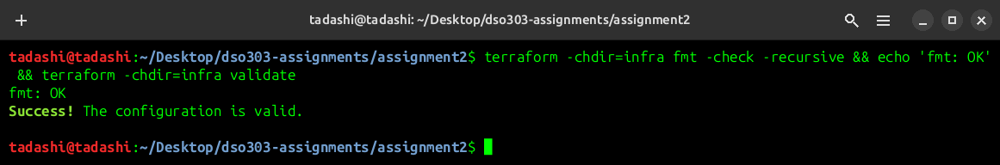
<p class="caption">Figure 15 – <code>terraform fmt -check</code> and <code>validate</code> pass.</p>

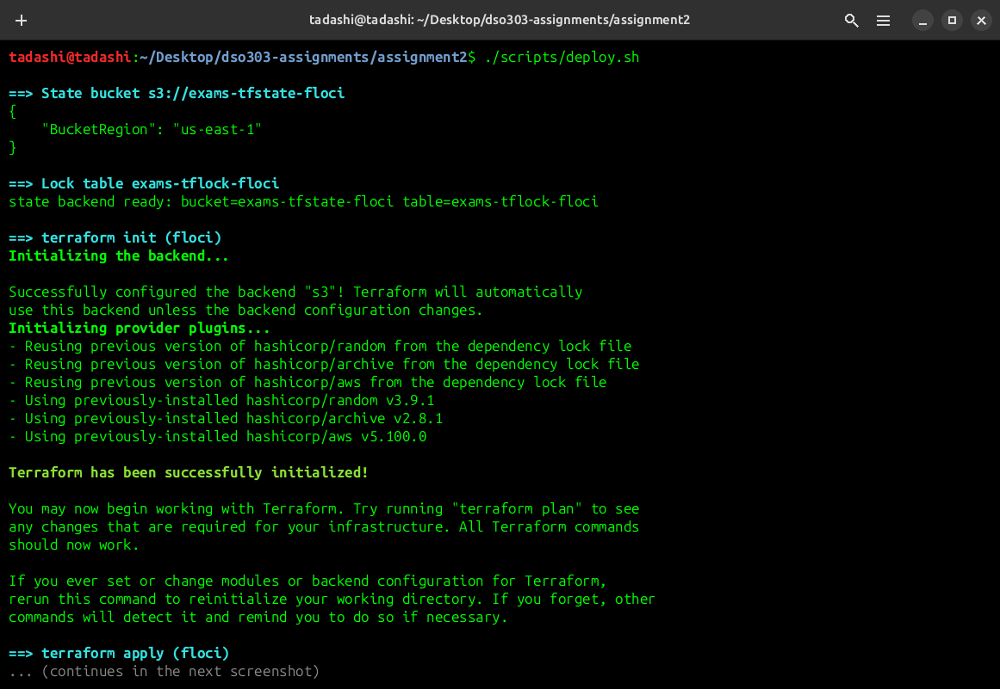
<p class="caption">Figure 16a – <code>./scripts/deploy.sh</code>: creates the S3 state bucket and DynamoDB lock table, then <code>terraform init</code> with the S3 backend.</p>

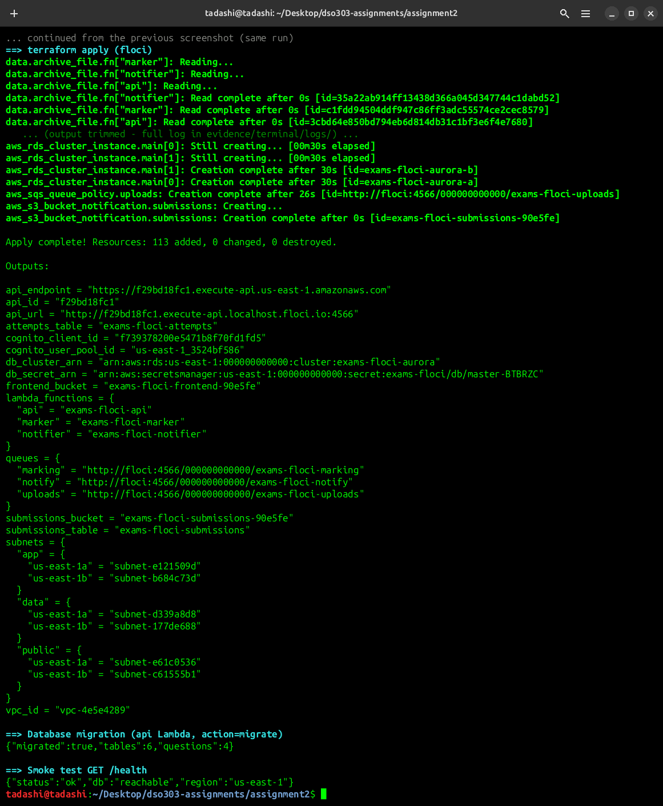
<p class="caption">Figure 16b – Same run: <b>Apply complete! Resources: 113 added</b>, outputs (subnets in both AZs, queues, tables), database migration through the api Lambda, and the <code>/health</code> smoke test reaching Aurora.</p>

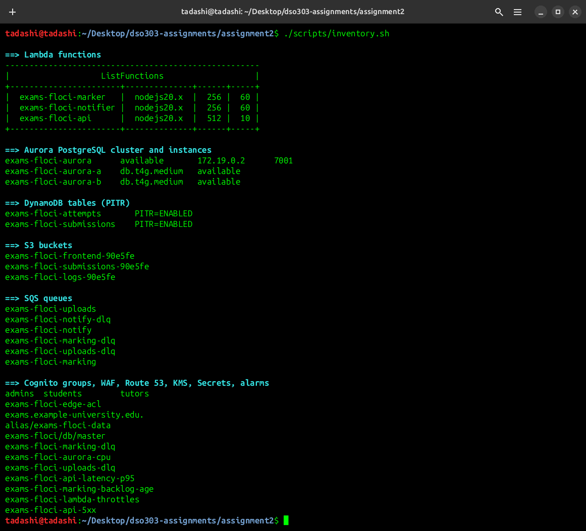
<p class="caption">Figure 17 – <code>./scripts/inventory.sh</code>: three Lambda functions, the Aurora cluster with instances <code>-a</code>/<code>-b</code>, DynamoDB with PITR enabled, three S3 buckets, six SQS queues (including DLQs), Cognito groups, the WAF web ACL, the Route 53 zone, the KMS alias, the secret and seven CloudWatch alarms.</p>

### 4.5 Walkthrough 1 executed on the deployed stack

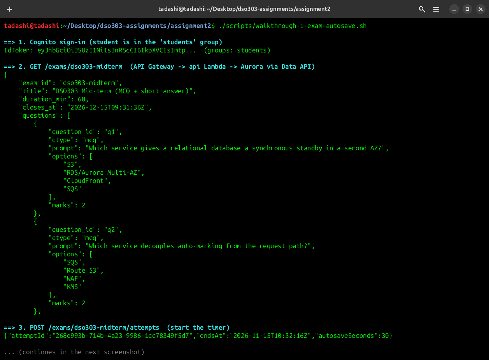
<p class="caption">Figure 18a – Cognito sign-in (student in the <code>students</code> group), then <code>GET /exams/dso303-midterm</code> returns questions from Aurora without answer keys, and the attempt starts.</p>

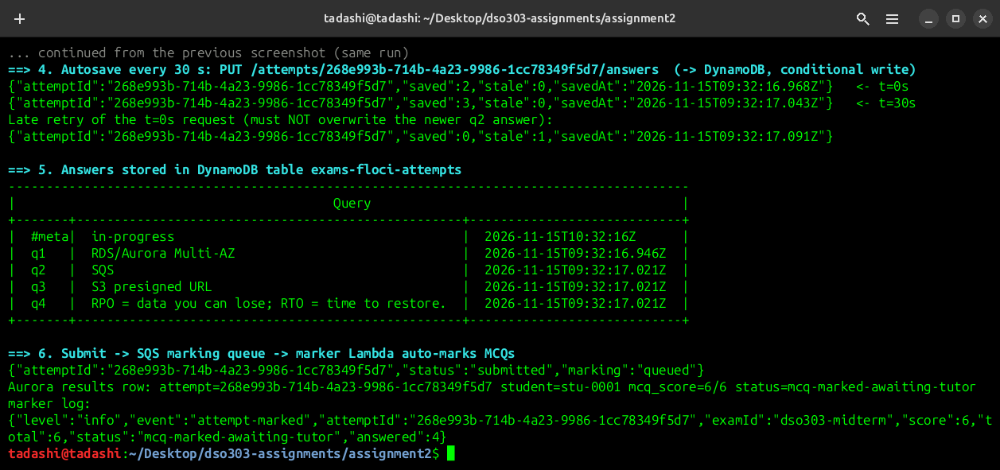
<p class="caption">Figure 18b – Autosave at t=0 s and t=30 s. A late retry of the t=0 s request is rejected as <b>stale</b> (no overwrite). The answers are in DynamoDB. Submit → SQS → marker Lambda → Aurora result <b>6/6</b>, with the marker's log line.</p>

### 4.6 Walkthrough 2 executed on the deployed stack

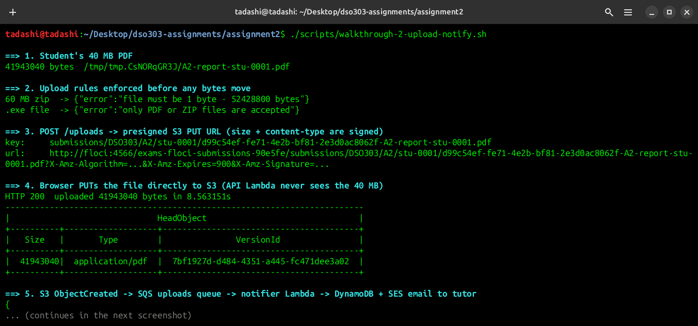
<p class="caption">Figure 19a – A 40 MB PDF. A 60 MB ZIP and a <code>.exe</code> are rejected before any upload. A presigned URL is issued and the browser-style PUT sends 41,943,040 bytes straight to S3 (versioned object).</p>

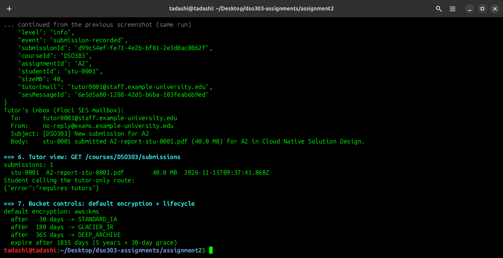
<p class="caption">Figure 19b – S3 event → SQS → notifier Lambda records the submission and <b>emails the tutor through SES</b> (message read back from Floci's SES mailbox). The tutor view lists the file, a student is refused the tutor route, and the bucket shows SSE-KMS and the 5-year lifecycle. In this run the notifier's first invocation timed out while the emulator was busy; SQS redelivered the message and the second attempt succeeded, which is the retry path working as designed.</p>

### 4.7 AZ failure executed on the deployed stack

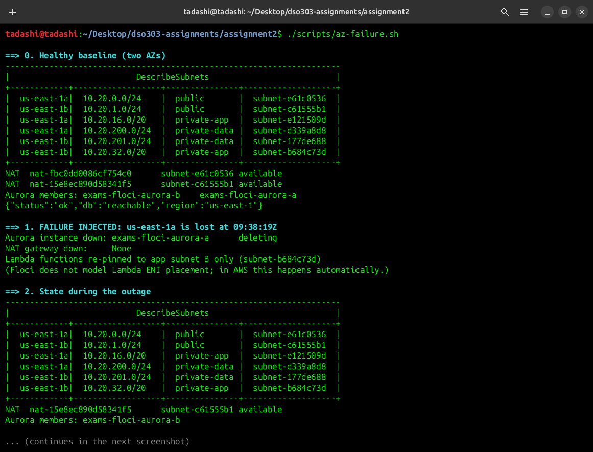
<p class="caption">Figure 20a – <code>./scripts/az-failure.sh</code>: baseline (subnets and NATs in both AZs, two Aurora instances), then us-east-1a is "lost": the Aurora instance in AZ-a is deleted, NAT gateway A is deleted (Floci's DeleteNatGateway response omits the id, hence "None"; the next listing shows only NAT B), and the Lambdas are pinned to app subnet B.</p>

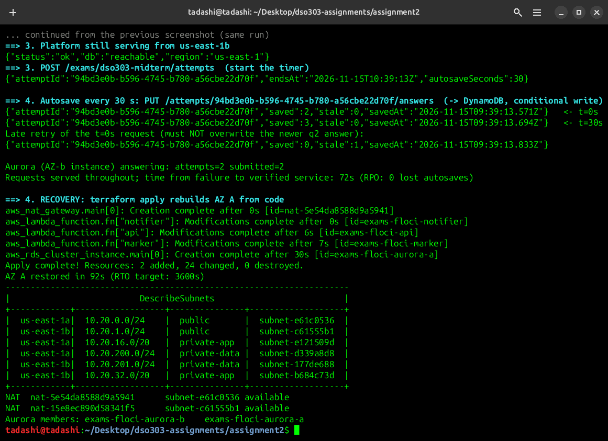
<p class="caption">Figure 20b – During the outage: <code>/health</code> OK, a new attempt and autosaves succeed, and Aurora answers from the AZ-b instance (72 s from failure to verified service, 0 autosaves lost). Recovery: <code>terraform apply</code> rebuilds NAT A and the Aurora AZ-a instance in <b>92 s</b> (RTO target 3,600 s).</p>

### 4.8 Infrastructure as code and CI/CD

- **Everything is in code:**
  - `infra/` (Terraform, ~113 resources);
  - `app/` (Lambda + SPA);
  - `scripts/` (deploy, walkthroughs, AZ failure, teardown);
  - `infra/bootstrap/` (prod state bucket, lock table, GitHub OIDC deploy role).
- **`.github/workflows/ci.yml`** runs on pull requests and branches: `terraform fmt`, `validate`, `node --check`, `shellcheck`, then an **integration job** that starts Floci and runs deploy → walkthrough 1 → walkthrough 2 → AZ failure → destroy.
- **`.github/workflows/deploy.yml`** runs on **push to `main`**:
  1. assume the AWS role through **GitHub OIDC** (no stored keys);
  2. `terraform plan` (saved plan artifact);
  3. `apply` in the protected `production` environment;
  4. run the database migration;
  5. run the `/health` smoke test.

### 4.9 Emulator limitations (stated honestly)

Floci does not implement several APIs, so `envs/floci.tfvars` and `use_floci` switch the following off. **They are all still defined in Terraform for real AWS.**

- **CloudFront distribution.** Floci's response omits `TrustedSigners` and crashes the AWS provider, so on Floci Route 53 publishes an `api.` CNAME instead. WAF, Route 53 and ACM are still created.
- **Cognito.** MFA is not supported.
- **CloudWatch.** Dashboards are not supported (`PutDashboard`).
- **Services not used on Floci.** AWS Backup and CloudTrail are skipped.
- **API Gateway.** The JWT authorizer is off. The identity it would extract is passed as `x-demo-*` headers, and Cognito sign-in itself is still shown. API Gateway also cannot target a Lambda alias on Floci.
- **Aurora.** Floci reports every instance in AZ-a and cannot run `FailoverDBCluster`. The Floci AZ test therefore proves the platform keeps serving with the AZ-a resources removed, and the lab (section 4.3) models the true Multi-AZ failover.
- **Not run on real AWS.** This submission was deployed to Floci, not to a real AWS account. `deploy.yml` targets real AWS but has not been run against an account.

## 5. Deploy and tear-down

```bash
./scripts/deploy.sh                       # state backend, terraform apply, migrate, smoke test (ENV=floci default)
./scripts/walkthrough-1-exam-autosave.sh
./scripts/walkthrough-2-upload-notify.sh
./scripts/az-failure.sh
./scripts/destroy.sh                      # tear down (DELETE_STATE=yes also removes the state bucket/table)
ENV=prod ./scripts/deploy.sh              # real AWS (normally via push to main)
```

Repository layout and full instructions: `README.md`. Service table source: `docs/services.md`. Walkthrough source: `architecture/walkthroughs.md`.
