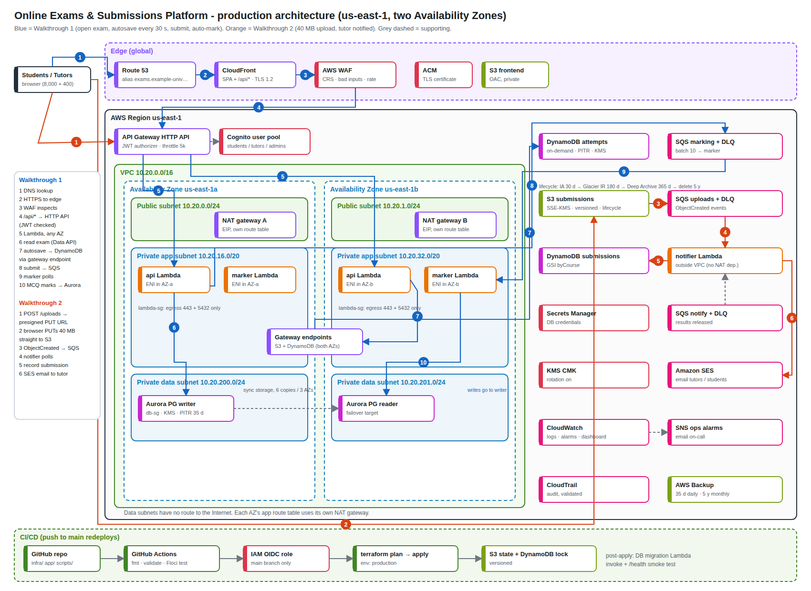

# Architecture, walkthroughs, peak and AZ loss

`diagram.svg` is the editable source (generated by `make_diagram.py`). The same design built in the Cloud Architecture Lab is in `../lab/exam-platform.reference.json`, and its export is in `../evidence/lab/00-lab-architecture-export.png`.

## Tiers across two Availability Zones

| Tier | us-east-1a | us-east-1b |
|---|---|---|
| Edge (global) | Route 53 → CloudFront + WAF (+ ACM), S3 frontend via OAC | same (global services) |
| Regional managed | API Gateway HTTP API, Cognito, DynamoDB, S3, SQS, SES, Secrets Manager, KMS, CloudWatch, CloudTrail, Backup (all multi-AZ by design) | same |
| Public subnet | `10.20.0.0/24` – NAT gateway A | `10.20.1.0/24` – NAT gateway B |
| Private app subnet | `10.20.16.0/20` – api + marker Lambda ENIs | `10.20.32.0/20` – api + marker Lambda ENIs |
| Private data subnet (no Internet route) | `10.20.200.0/24` – Aurora writer | `10.20.201.0/24` – Aurora reader / failover target |

## Walkthrough 1 – a student opens an exam and answers autosave

1. **DNS.** The browser resolves `exams.example-university.edu`. Route 53 returns the CloudFront alias.
2. **Edge.** CloudFront serves the SPA from S3 (cached). The student is already signed in through Cognito and holds a JWT that carries the `students` group.
3. **WAF.** `GET /api/exams/dso303-midterm` passes the managed rules and the rate rule.
4. **API.** CloudFront forwards `/api/*` (uncached) to the HTTP API. The **JWT authorizer** validates the Cognito token before anything runs.
5. **Compute.** API Gateway invokes the `api` Lambda (`live` alias, provisioned concurrency in exam windows). Lambda runs it in whichever AZ's private subnet has capacity.
6. **Read exam.** The Lambda reads the exam and questions from **Aurora** through the RDS **Data API**, never selecting `answer_key`. `POST …/attempts` creates the attempt row and its deadline in Aurora, plus a `#meta` item in DynamoDB.
7. **Autosave every 30 s.** The browser sends `PUT /api/attempts/{id}/answers` with `clientTs`. The Lambda checks the `#meta` item (owner, not submitted, not past the deadline), then does **conditional `UpdateItem`s** into **DynamoDB** through the gateway endpoint. A write is only accepted if `clientTs` is newer, so a delayed retry cannot overwrite a newer answer. The browser also keeps a `localStorage` copy. Worst-case loss is one 30 s interval, well inside the 5-minute RPO.
8. **Submit.** `POST …/submit` flips `#meta` to `submitted` and sends `{attemptId}` to the **SQS marking queue**. The student gets `202` immediately.
9. **Mark.** The `marker` Lambda polls 10 messages at a time, loads the answer key from Aurora and the answers from DynamoDB, and scores the MCQs.
10. **Result.** It writes `results` to the **Aurora writer** (short answers are flagged for the tutor). Failures go back to the queue and then to the DLQ, which raises an alarm.

**Proven on Floci:** `evidence/terminal/04-walkthrough-1-*.png`. **Proven in the Lab:** `evidence/lab/02` and `03`.

## Walkthrough 2 – a student uploads a 40 MB assignment and the tutor is notified

1. **Request upload.** The browser calls `POST /api/uploads {courseId, assignmentId, fileName, size}` (same edge path and JWT check as walkthrough 1). The `api` Lambda rejects anything that is not PDF/ZIP or is over 50 MB, then returns a **presigned S3 PUT URL** (15 min) whose signature includes the exact `Content-Length` and `Content-Type`.
2. **Upload.** The browser **PUTs the 40 MB file directly to S3**. It never passes through API Gateway (10 MB limit) or Lambda (6 MB limit). S3 stores it SSE-KMS encrypted and versioned under `submissions/<course>/<assignment>/<student>/…`, where the lifecycle rules apply.
3. **Event.** S3 publishes `ObjectCreated` to the **SQS uploads queue**.
4. **Process.** The `notifier` Lambda (outside the VPC) polls the queue and runs `HeadObject` to read the real size and type.
5. **Record.** It writes the submission to the **DynamoDB submissions** table (GSI `byCourse`) and looks up the course tutor in Aurora.
6. **Notify.** It calls **SES `SendEmail`** to the tutor. The tutor sees the submission in `GET /api/courses/DSO303/submissions`.

**Proven on Floci:** `evidence/terminal/05-walkthrough-2-*.png` (40 MB PUT, the email in the SES mailbox). **Proven in the Lab:** `evidence/lab/04` and `05`.

## How the design handles the exam peak and the loss of one AZ (300 words)

**Exam peak.** 3,000 students opening one exam within 5 minutes is about 10 requests/s on average, with bursts in the first minute. Autosave then adds 3,000 ÷ 30 s ≈ **100 writes/s**. Nothing in the request path needs pre-provisioned servers. CloudFront serves the SPA from the edge, so the API only sees API calls. The HTTP API stage allows a 5,000 burst. The `api` Lambda has **600 reserved concurrency**, so marking can never starve it. `scripts/exam-window.sh` sets **300 provisioned concurrency** before a scheduled exam to remove cold starts. Autosaves go to **on-demand DynamoDB**, not the relational database, and the RDS **Data API** means no database connection pool to exhaust. Submissions are buffered in **SQS**: marking happens at its own pace (reserved concurrency 50) and the student still gets an instant `202`. Uploads bypass the API through presigned S3 URLs. WAF's per-IP limit is high because a whole exam hall shares one campus IP.

**Loss of one AZ.** Every stateful or routed component exists in both zones. Lambda places ENIs in both private app subnets and stops using the failed one. Each AZ has **its own NAT gateway and route table**, and the notifier runs outside the VPC, so no traffic depends on the lost zone. Aurora's storage is replicated six ways across three AZs. If the writer's AZ fails, the reader in us-east-1b is promoted (typically under 60 s) and the cluster endpoint follows it, with no committed data lost. DynamoDB, S3, SQS, API Gateway, Cognito, CloudFront and Route 53 are regional or global services that tolerate an AZ loss. The answer RPO is at most 30 s (autosave interval, PITR), and the database RPO is about 0. The RTO is minutes, and `terraform apply` rebuilds lost AZ resources. Both well inside the 5-minute RPO and 1-hour RTO targets.
