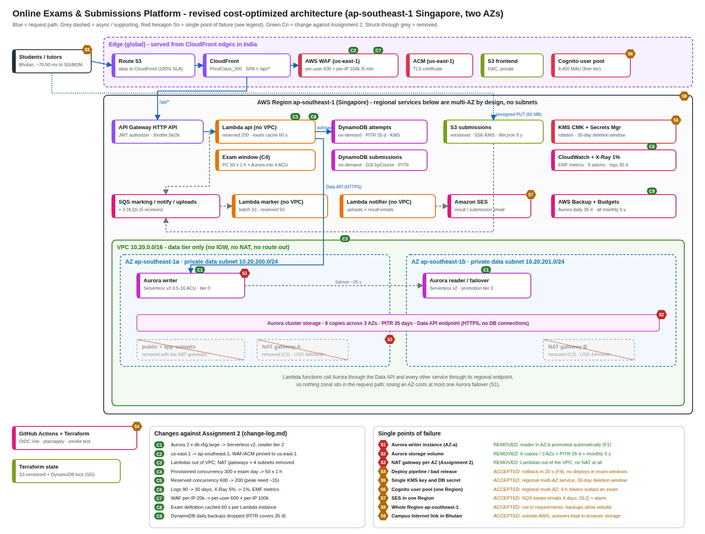

# DSO303 Assignment 3 – Cost, Feasibility and Resilience Analysis

The Assignment 2 online exams platform, moved to **Asia Pacific (Singapore), ap-southeast-1**, costed for a year, made cheaper, load-tested and failure-tested.



## Summary

* **Scenario:**
  * 10 normal months with 300–500 concurrent users;
  * 2 exam months with 3,000 students starting one exam within 5 minutes;
  * budget **USD 1,000 per month averaged over the year**;
  * RPO 5 min, RTO 1 h, survive the loss of one AZ, files kept 5 years.
* **Cost** (AWS Price List API prices, published 2026-11-11, checked 2026-11-15):

  | | Normal month | Exam month | **Year** | Avg / month | Per student / year |
  |---|---:|---:|---:|---:|---:|
  | Assignment 2 design in Singapore | $720.01 | **$1,220.29** | $9,640.68 | $803.39 | $1.21 |
  | **Assignment 3 revised design** | **$363.57** | **$440.83** | **$4,517.36** | **$376.45** | **$0.56** |

* **Five optimizations** save **$5,123 a year (−53%)**:
  * Aurora → Serverless v2: −$2,820
  * Lambdas out of the VPC, no NAT gateways: −$1,055
  * provisioned concurrency sized by the load test: −$883
  * DynamoDB out of the daily backups: −$479
  * X-Ray sampling: −$42
* **Load test:** the exam-start surge exposed one proven bottleneck (B1) and two reasoned ones (B2, B3). Before the fix 37.7% of requests succeeded; after it, **100% with p95 257 ms**.
* **Failure tests:** four scenarios run and measured. **0 answers / submissions / bytes lost**; the slowest full recovery took **296 s**, against a 3,600 s target.
* **Region:** Singapore vs Mumbai. Mumbai is 7.4% cheaper ($4,182/yr) and ~25 ms closer to Bhutan (63 ms vs 87 ms measured). Singapore is kept: it is the Region requested and the difference does not affect a 30 s autosave.

## Feasibility verdict

**Feasible.**

| Target | Result | |
|---|---|---|
| Budget ≤ $1,000/month (yearly average) | **$376.45** average; the dearest month (exam) is $440.83 | ✅ 62% headroom |
| Peak: 3,000 students in 5 min | ~110 req/s, ~15 concurrent Lambdas needed. 200 reserved, 50 pre-warmed. Load test after the fixes: 100% success, p95 257 ms | ✅ |
| RPO 5 min | Measured 0 lost in all four tests (autosave every 30 s + browser copy + PITR) | ✅ |
| RTO 1 h | Measured 28 s – 296 s; Aurora AZ failover ~30 s | ✅ |
| Lose one AZ | Only the Aurora writer is zonal, and it has a reader in the other AZ (test F1) | ✅ |
| 5-year retention | S3 lifecycle to Deep Archive + AWS Backup monthly kept 5 years | ✅ |

Full numbers are in [docs/cost-report.md](docs/cost-report.md).

## Links

| What | Link |
|---|---|
| AWS Pricing Calculator – normal month | _add share link_ (expected total $363.57) |
| AWS Pricing Calculator – exam month | _add share link_ (expected total $440.83) |
| Demo video (≤ 5 min, own voice: one failure test + the load test) | _add video link_ |

The values to enter in the calculator are listed in [evidence/calculator/README.md](evidence/calculator/README.md).

## Task 1 – Revised architecture

* [architecture/diagram.png](architecture/diagram.png) (source `diagram.svg`, generated by `make_diagram.py`). Every single point of failure is marked S1–S9 as removed or accepted, and every change is tagged C1–C9.
* [architecture/change-log.md](architecture/change-log.md): the nine changes against Assignment 2 and the SPOF table.

## Task 2 – Cost and service report

[docs/cost-report.md](docs/cost-report.md) covers:
* the per-service monthly cost for both profiles, with hidden costs (data transfer out, NAT processing, CloudWatch Logs, KMS requests, backups, Data API);
* the annual total and the cost per student;
* the three most expensive components;
* five service comparisons;
* the Singapore vs Mumbai comparison with measured latency from Bhutan;
* the optimizations and the verdict.

## Task 3 – Implementation

### Costed estimate

* `tools/extract_prices.py` pulls 49 unit prices per Region from the AWS Price List API into `evidence/pricing/`.
* `tools/cost_model.py` applies them to both load profiles and writes calculator-format estimates to `evidence/calculator/` (screenshot `evidence/terminal/11-cost-model.png`).

### Load test and bottlenecks

`scripts/load-test.sh before|after` runs students opening one exam and autosaving every 30 s against the Floci deployment.
* **Scale.** The laptop emulator cannot host 3,000 students, so the same shape runs at 1/15 of the arrival rate: 40 students in 60 s.
* **Measurements.** The driver publishes requests, 5xx and p95 every 10 s to CloudWatch (`ExamPlatform/LoadTest`, read back with `GetMetricStatistics`).
* **CloudWatch Logs.** The api Lambda writes one **CloudWatch Embedded Metric Format** line per request, giving route, duration, SQL calls and SQL time. New log streams count cold starts.

| Run | Success | p95 | Cold starts | `GET /exams` SQL calls / SQL ms per request | Evidence |
|---|---:|---:|---:|---:|---|
| **before** (A2 behaviour: no cache, no pre-warm) | 37.74% (66 × 5xx) | 30,003 ms | 10 | **2.00 / 15,013 ms** of 15,060 ms | `evidence/terminal/05-load-test-before.png` |
| **after** (C8 cache + C4 exam window) | **100%** (240/240) | **257 ms** | **0** | **0.10 / 20 ms** | `evidence/terminal/06-load-test-after.png` |

**B1 – proven.** At exam start every student's `GET /exams` ran two Aurora queries through the Data API, on freshly started Lambda environments. CloudWatch shows:
* 99.7% of that request's time was spent in SQL;
* there were 10 cold starts.

Autosaves, which use no SQL, stayed fast. The fix has two parts:
* **C8:** cache the exam and its questions for 60 s per Lambda instance;
* **C4:** `exam-window.sh open` pre-warms 50 instances and raises Aurora's minimum to 4 ACU.

The re-test is the "after" row. This bottleneck also exists in AWS, though smaller: 3,000 opens × 2 queries in a few minutes against a 0.5-ACU database.

**B2 – reasoned: WAF would block an exam hall.** Assignment 2 limited each IP to 20,000 requests per 5 min. A hall of 3,000 students behind one campus NAT IP sends 3,000 × 10 autosaves = **30,000 per 5 min**, so WAF would have blocked the whole hall about 3½ minutes into the exam. The fix (C7):
* a per-user limit of 600 per 5 min, keyed on the Authorization header;
* the per-IP limit raised to 100,000;
* a `waf-blocked` alarm.

**B3 – reasoned: concurrency quota and cold database.**
* **Lambda.** New AWS accounts can start with a Lambda concurrency quota far below 1,000. The A2 reservation of 600 needs at least 700, otherwise the deploy fails or marking is starved. Little's law gives the real need: 110 req/s × 0.06–0.13 s ≈ 15 concurrent executions. Reserved concurrency is now 200 (C5); request a quota of ≥ 1,000 before the first exam.
* **Aurora.** Serverless v2 starting from 0.5 ACU needs some seconds to scale up. The exam window sets the minimum to 4 ACU for that hour (C4), and the `aurora-acu-high` alarm watches the ceiling.

### Failure tests

Scenarios, expected impact, measurements and fixes are in [infra/failure-tests/README.md](infra/failure-tests/README.md).

| # | Scenario | RPO measured | RTO measured |
|---|---|---|---|
| F1 | Loss of AZ ap-southeast-1a (Aurora writer) during an exam | 0 answers lost | serving after 30 s, rebuilt in 184 s |
| F2 | Marking worker outage after an exam | 0 submissions lost | 296 s |
| F3 | Submitted file deleted by mistake | 0 bytes (identical SHA-256) | 28 s |
| F4 | Broken API release mid-exam | 0 answers lost | 54 s (135 s incl. browser re-sync) |

F5–F7 (DynamoDB/Aurora point-in-time restore, Region loss) are documented runbooks; Floci cannot run them.

## Repository layout

```
README.md                    this file
architecture/                diagram.png/.svg (+ make_diagram.py), change-log.md (changes C1-C9, SPOFs S1-S9)
docs/cost-report.md          Task 2 cost and service report
infra/                       Terraform (ap-southeast-1): Aurora Serverless v2, DynamoDB, S3, SQS, SES, Lambda, API GW, WAF/ACM in us-east-1
  failure-tests/             F1-F4 scripts, exam-traffic.mjs (RPO measurement), README.md (scenarios, impact, fixes)
  envs/                      prod / floci tfvars + backend configs
app/                         Lambda code (api with EMF metrics and exam cache, marker, notifier) + SPA
scripts/                     deploy, destroy, inventory, walkthroughs, exam-window, load-test(.sh/.mjs), region-latency
tools/                       extract_prices.py (Price List API -> JSON), cost_model.py (both profiles, both Regions)
evidence/calculator/         estimates per Region/design/profile (CSV), summary.json, calculator input sheet
evidence/pricing/            unit prices used, with AWS usageType, publication date
evidence/terminal/           terminal screenshots (+ logs/) of deploy, inventory, load tests, failure tests, latency, cost model
REPORT.md / .html / .pdf     assembled report
```

## How to run (Floci, the AWS emulator used in the module)

```bash
./scripts/deploy.sh                          # state backend, terraform apply (ap-southeast-1), DB migration, /health
./scripts/inventory.sh                       # what is deployed (no NAT, Lambdas outside the VPC, Serverless v2, WAF rules)
./scripts/load-test.sh before                # A2 behaviour: cold surge, every exam open hits Aurora
./scripts/load-test.sh after                 # with the exam cache and the exam window
./infra/failure-tests/f1-az-loss.sh          # and f2-marking-outage.sh, f3-deleted-submission.sh, f4-bad-deploy.sh
./scripts/region-latency.sh                  # Bhutan -> Region round trips
python3 tools/cost_model.py                  # monthly / annual / per-student costs, writes evidence/calculator/
./scripts/destroy.sh
```

`load-test.sh` seeds its own students (`lt-0001`…`lt-3000`). Every run uses a fresh range, because an attempt can only be started once per student.

**Production:** `ENV=prod ./scripts/deploy.sh` or push to `main`; `.github/workflows/deploy.yml` deploys to ap-southeast-1.
* Before each exam: `ENV=prod ./scripts/exam-window.sh open`.
* About an hour after the start: `ENV=prod ./scripts/exam-window.sh close`.

**Floci differences.** Floci has no CloudFront distribution, Backup, Budgets, X-Ray rules, Aurora failover, snapshots or PITR restore, and it does not publish AWS/Lambda metrics. The scripts work around these and say so in their output. Floci also runs the API Lambda with a 30 s timeout instead of 10 s, because its cold starts take 10–40 s on a laptop.
