# DSO303 Assignment 3 – Cost, Feasibility and Resilience Analysis

## 1. Scenario, targets and answer in one table

The Assignment 2 platform must run in **ap-southeast-1** for 10 normal months (300–500 concurrent users) and 2 exam months (peak: 3,000 students start one exam within 5 minutes). The budget is **USD 1,000 per month averaged over the year**. The targets are unchanged: RPO 5 min, RTO 1 h, survive the loss of one AZ, files kept 5 years.

| Target | Result | Evidence |
|---|---|---|
| Budget ≤ $1,000/month (yearly average) | **$376.45 average** · normal $363.57 · exam $440.83 · year $4,517.36 · **$0.56 per student per year** | §3, Figure 2 |
| Peak load | 100% success, p95 257 ms after fixing bottleneck B1 (37.7% success before) | §4.2, Figures 6–7 |
| RPO 5 min | 0 answers, submissions or bytes lost in all four failure tests | §4.3 |
| RTO 1 h | 28 s – 296 s measured | §4.3 |
| Loss of one AZ | Only the Aurora writer is zonal; its reader in AZ-b takes over (F1) | §2, Figure 8 |
| 5-year retention | S3 lifecycle to Deep Archive; AWS Backup monthly copies kept 5 years | §3 |

**Verdict: feasible**, with 62% budget headroom.

## 2. Task 1 – Revised architecture design

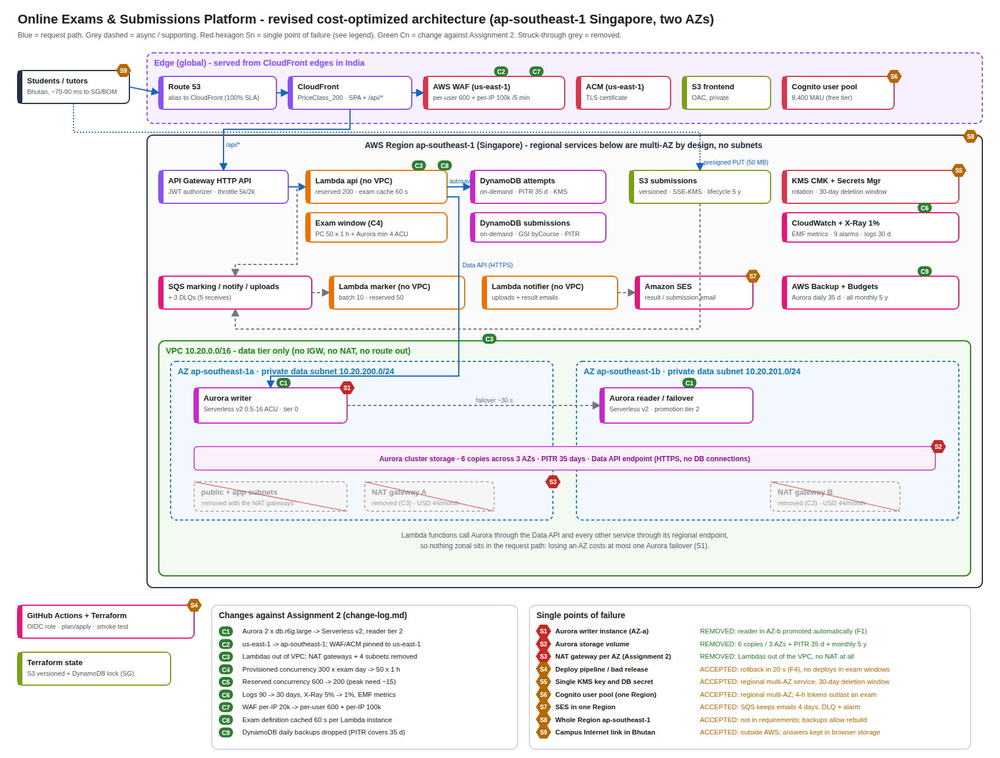

Figure 1 – Revised cost-optimized architecture in ap-southeast-1. Red and amber hexagons S1–S9 are single points of failure; green tags C1–C9 are changes against Assignment 2 (source: <code>architecture/diagram.svg</code>).

## 4. Task 3 – Implementation

### 4.1 Costed estimate

* `tools/extract_prices.py` reads the AWS Price List API offer files (the calculator's price source) and stores the 49 unit prices used per Region, with `usageType` and description, in `evidence/pricing/`.
* `tools/cost_model.py` applies them to both load profiles for both designs and both Regions. It writes calculator-format estimates (`evidence/calculator/estimate-*.csv`) and `summary.json`.
* The calculator share links for the two Singapore profiles go in README.md. The exact values to enter are in `evidence/calculator/README.md`.

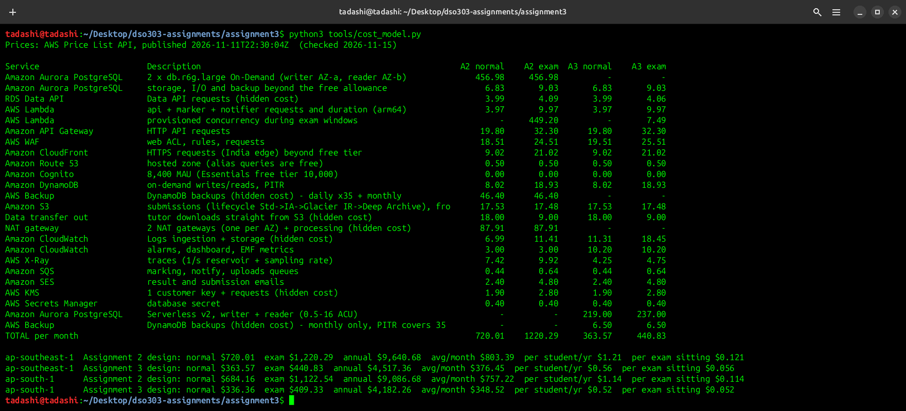

Figure 2 – Cost model run: every service for A2 vs A3, normal vs exam month, and the yearly totals for Singapore and Mumbai.

The optimizations and the saving of each are in §3 (section 6 of the cost report): **O1** Serverless v2 −$2,819.76/yr, **O2** no NAT −$1,054.92/yr, **O3** provisioned concurrency −$883.42/yr, **O4** backups −$478.80/yr, **O5** X-Ray −$42.04/yr. **Net −$5,123.32/yr (−53%).**

### 4.2 Deployment in Singapore and load test

The revised Terraform was deployed to Floci (the module's AWS emulator) in ap-southeast-1.

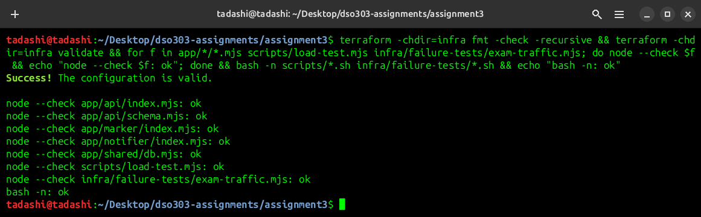

Figure 3 – terraform fmt/validate, node --check and bash -n on the Assignment 3 code.

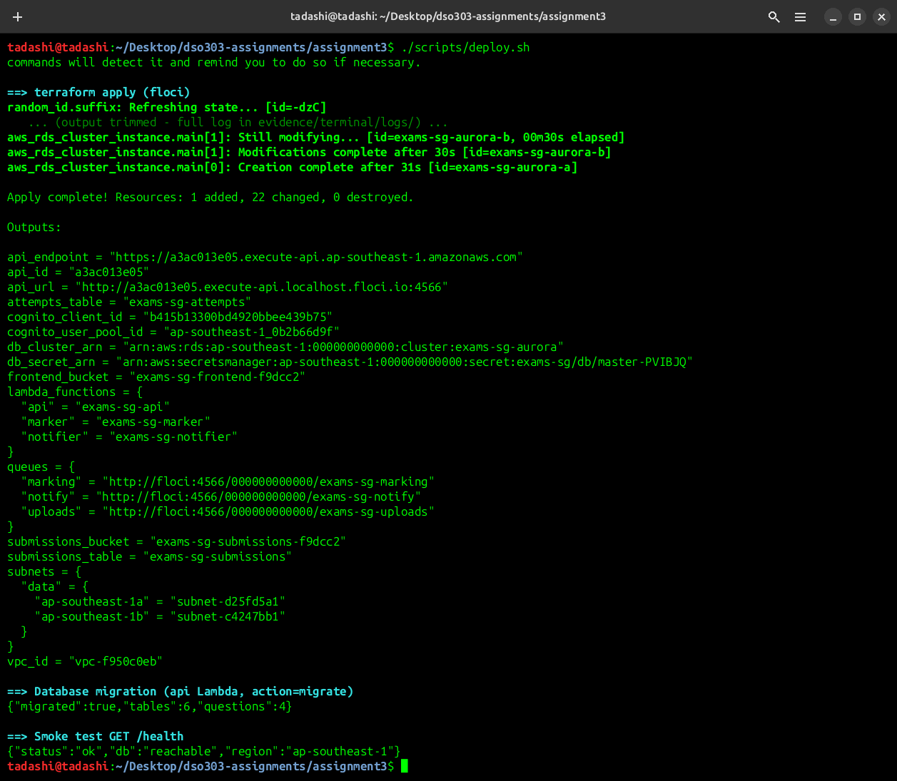

Figure 4 – Deployment to ap-southeast-1: outputs show only the two private data subnets, the Data API migration and the health check.

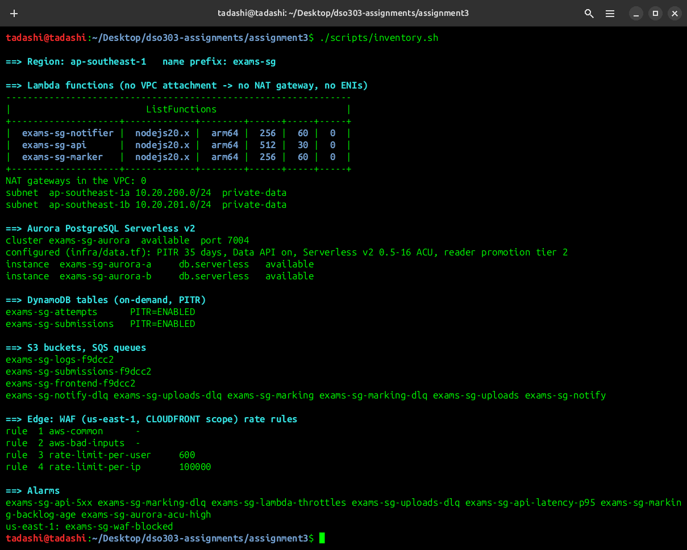

Figure 5 – Inventory: Lambdas with 0 VPC subnets, 0 NAT gateways, Aurora db.serverless writer + reader, PITR on, WAF (us-east-1) per-user 600 and per-IP 100,000 rules, alarms in both Regions.

**Load test method.** `scripts/load-test.sh` runs the exam-start shape: students arrive evenly, each opens the exam (`GET /exams/{id}`), starts an attempt and then autosaves every 30 s.
* **Scale.** A laptop emulator cannot host 3,000 students, so the run uses 40 students in 60 s, 1/15 of the real arrival rate.
* **Driver metrics.** The driver publishes requests, 5xx and p95 every 10 s to CloudWatch (`ExamPlatform/LoadTest`) and reads them back with `GetMetricStatistics`.
* **Lambda metrics.** The api Lambda writes a **CloudWatch Embedded Metric Format** line per request (`Route`, `DurationMs`, `DbCalls`, `DbMs`). In AWS these become metrics automatically; on Floci they are read from CloudWatch Logs.
* **Cold starts.** Counted as new Lambda log streams.

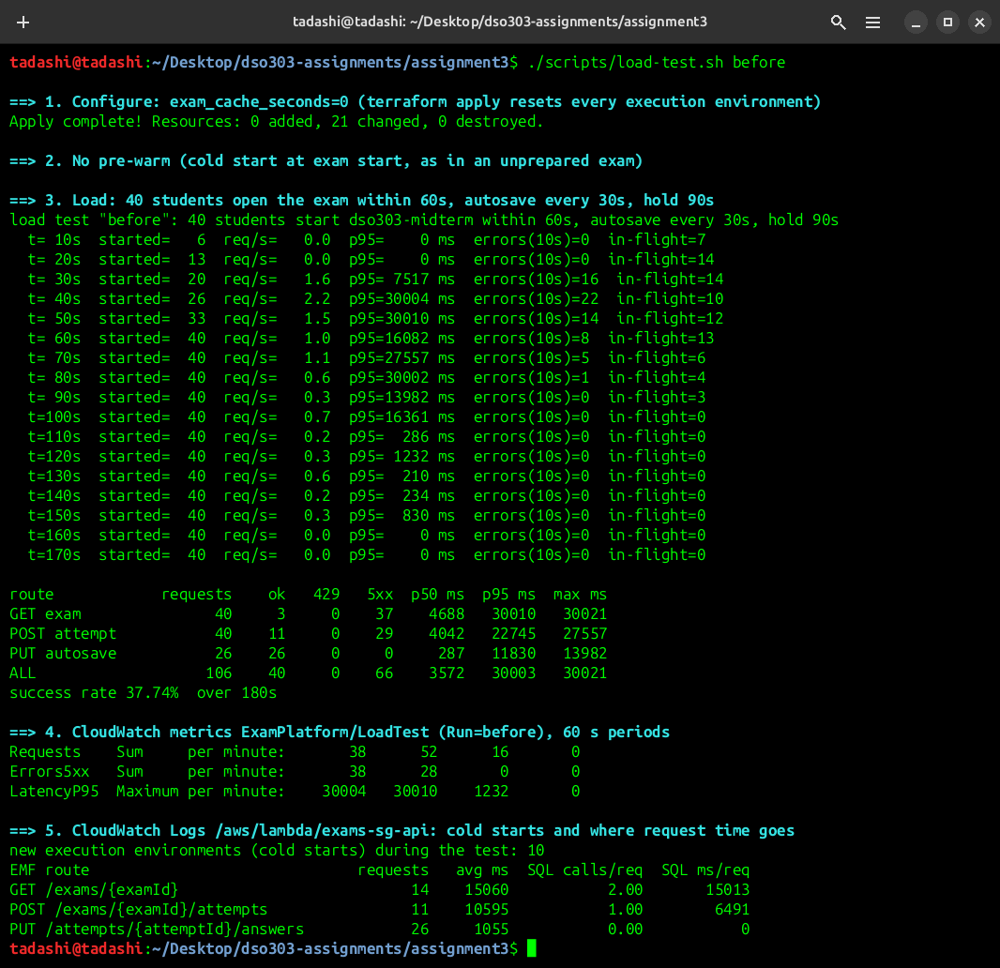

Figure 6 – Before (Assignment 2 behaviour): 37.74% success, p95 30 s, 10 cold starts. CloudWatch Logs (EMF) show <code>GET /exams</code> spending 15,013 ms of its 15,060 ms in 2 SQL calls, while autosaves (0 SQL) stay fast.

**Bottleneck B1 (proven).** Opening the exam is the hot spot at exam start. Every student ran two Aurora queries through the Data API, on newly started Lambda environments, so the database path and cold starts carried the whole surge. The fix has two parts:
* **C8:** the exam and its questions are cached for 60 s in each Lambda instance;
* **C4:** `exam-window.sh open` pre-warms 50 instances (provisioned concurrency) and raises Aurora's minimum to 4 ACU before the exam.

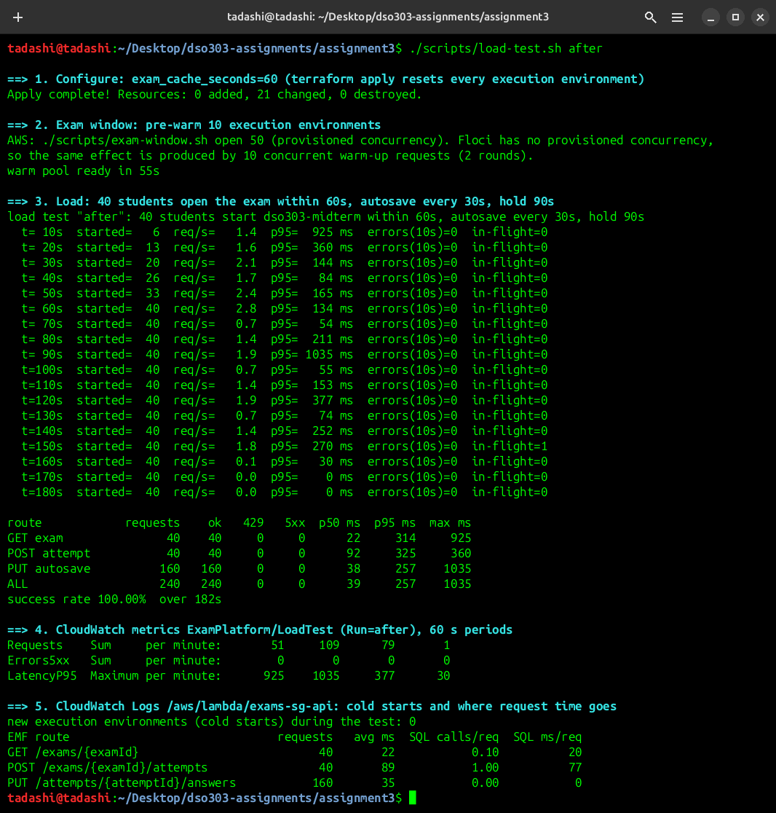

Figure 7 – Re-test after the fix: 240/240 requests succeed, p95 257 ms, 0 cold starts; <code>GET /exams</code> now averages 0.10 SQL calls and 20 ms of SQL.

**Bottleneck B2 (reasoned): WAF would block an exam hall.** The Assignment 2 rule allowed 20,000 requests per 5 min per IP. An exam hall of 3,000 students behind one campus NAT address sends 3,000 × 10 = 30,000 autosaves per 5 min, so WAF would have blocked everyone in the hall a few minutes into the exam. Fixed by C7:
* per-user 600 per 5 min (Authorization header);
* per-IP 100,000 per 5 min;
* a `waf-blocked` alarm in us-east-1.

**Bottleneck B3 (reasoned): concurrency quota and a cold database.**
* **Lambda.** The peak needs only about 15 concurrent executions (110 req/s × 60–130 ms, Little's law). Assignment 2 reserved 600, which needs an account quota of at least 700; new accounts often start lower. Fixed by C5: 200 reserved, and a quota of ≥ 1,000 requested before the first exam.
* **Aurora.** Serverless v2 starting from 0.5 ACU needs seconds to scale. The exam window sets the minimum to 4 ACU, and the `aurora-acu-high` alarm guards the 16 ACU ceiling.

### 4.3 Failure tests

Four scenarios were injected into the running Singapore deployment while `exam-traffic.mjs` acted as students autosaving every 3 s. A failed save is kept and re-sent, as the SPA does with its browser copy, and at the end every client's newest answer is compared with DynamoDB. Details, expected impact and fixes are in `infra/failure-tests/README.md`.

| # | Scenario | Expected impact | Measured RPO | Measured RTO | Fix |
|---|---|---|---|---|---|
| F1 | Loss of AZ ap-southeast-1a (Aurora writer) mid-exam | Opens/submits fail during Aurora failover (~30 s in AWS); autosaves and SPA unaffected; no NAT/ENI to lose | **0 answers lost** | serving again in 30 s; AZ-a rebuilt in 110 s; incident 184 s | Multi-AZ failover; `terraform apply` rebuilds the lost instance |
| F2 | Marking worker down after an exam | Submits still accepted (202); attempts wait in SQS; results late | **0 submissions lost** | backlog drained 180 s after fix; incident 296 s | Restore from code; backlog-age and DLQ alarms; DLQ redrive |
| F3 | Submitted file deleted by mistake | Tutor gets 404 | **0 bytes** (identical SHA-256) | 28 s | S3 versioning: remove the delete marker; Object Lock recommended |
| F4 | Broken API release mid-exam | All calls 5xx; browser keeps answers | **0 answers lost** | rolled back in 20 s; outage 54 s; re-synced at 135 s | Alias rollback / redeploy last good build; no deploys in exam windows |

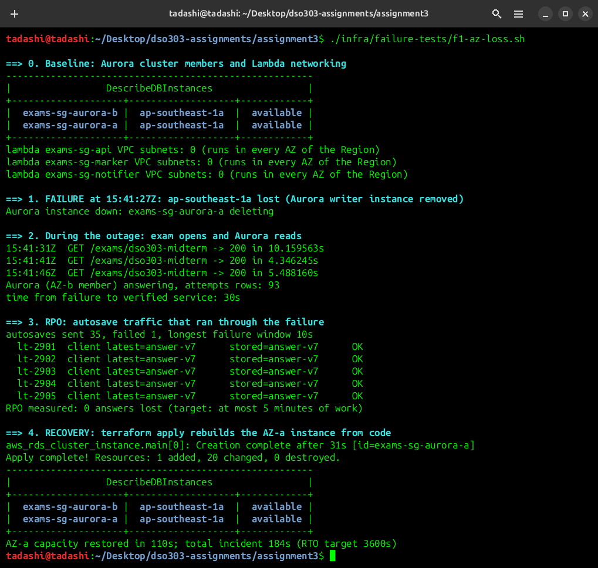

Figure 8 – F1: AZ-a Aurora instance removed during live autosave traffic; exam opens still served; 0 answers lost; terraform rebuilds AZ-a.

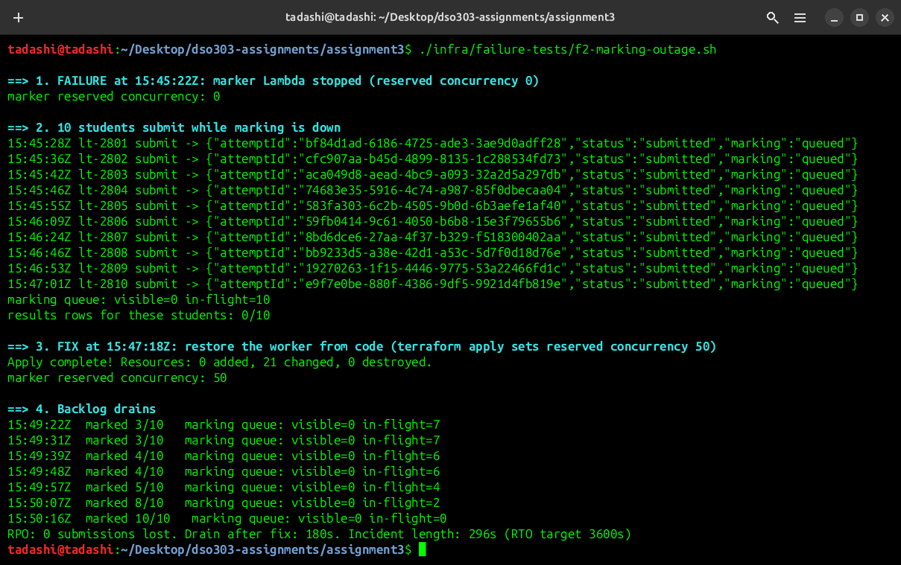

Figure 9 – F2: marker stopped, 10 students submit, the queue holds them, the fix drains the backlog to 10/10 marked.

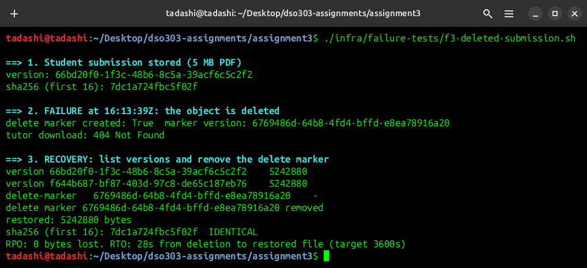

Figure 10 – F3: deleted submission restored from its S3 version, byte-identical, in 28 s.

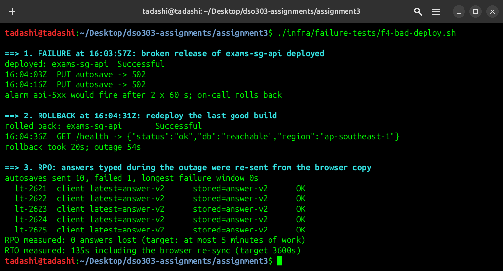

Figure 11 – F4: broken release returns 502, rollback in 20 s, every client's newest answer present in DynamoDB.

Not runnable on Floci (no PITR restore or snapshots), documented as runbooks with expected numbers:
* F5: DynamoDB point-in-time restore, RPO seconds, RTO ~20–40 min;
* F6: Aurora point-in-time restore, RPO ≤ 5 min, RTO ~30–45 min;
* F7: Region loss, accepted.

### 4.4 Region latency from Bhutan and regression check

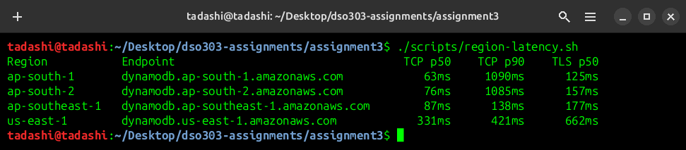

Figure 12 – Round trips from the author's machine in Bhutan (20 samples each): Mumbai 63 ms, Hyderabad 76 ms, Singapore 87 ms, N. Virginia (Assignment 2 Region) 331 ms.

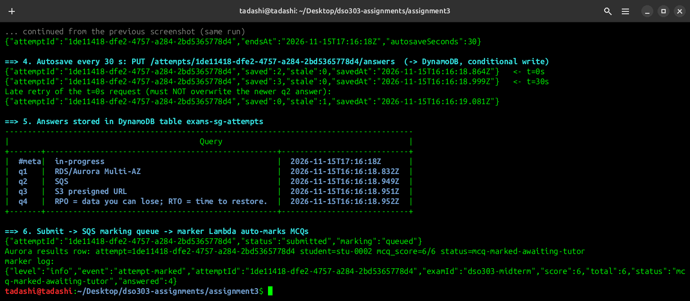

Figure 13 – Regression: Assignment 2 walkthrough 1 (start attempt, autosave with stale-retry protection, submit, auto-mark) still passes on the revised Singapore stack.

## 5. Conclusion

The platform is **affordable**: $4,517 a year, an average of $376 a month against a $1,000 budget, or $0.56 per student per year. It is **resilient** to the failures that matter during an exam. The analysis changed the design in nine places:
* the largest costs (two always-on database instances, NAT gateways, an oversized provisioned-concurrency setting) were removed or right-sized;
* two hidden costs (full-copy DynamoDB backups, NAT processing) were cut;
* the load test found two issues that would have hurt a real exam: per-request database reads at exam start and a WAF limit that would block a shared campus IP.

What remains are accepted, documented risks: single Region, single Cognito pool and SES, and the campus Internet link. Each is mitigated by queues, browser storage or a rebuild plan.
