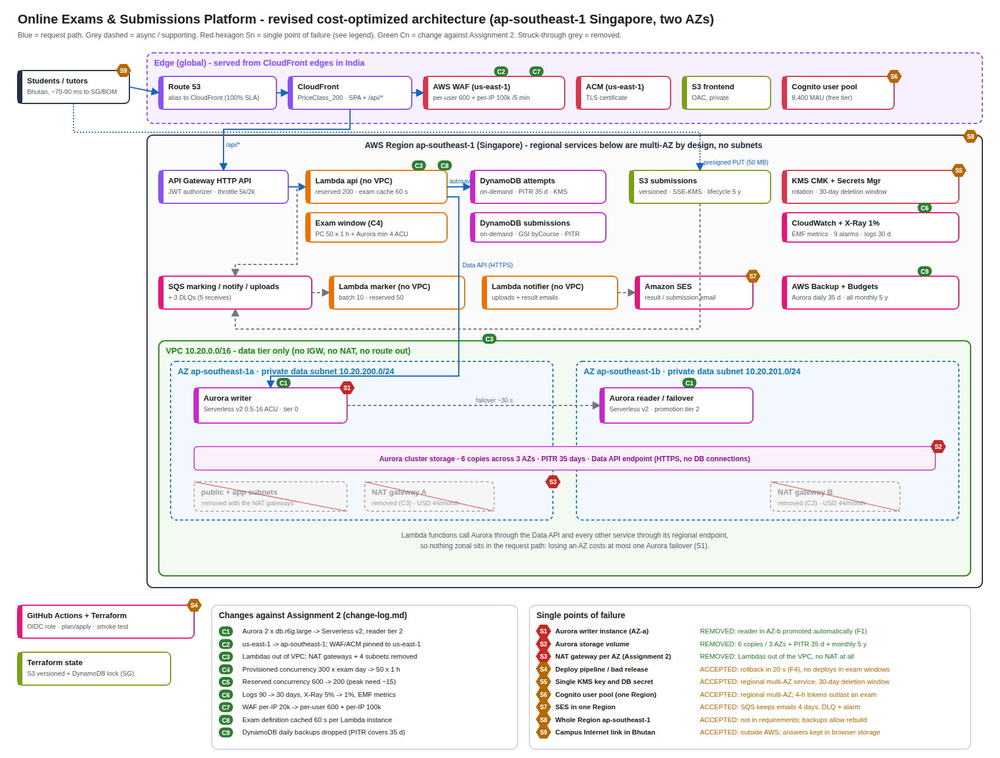

# Architecture change log – Assignment 2 → Assignment 3

`diagram.svg` is generated by `make_diagram.py`. On the diagram:
* green **C1–C9** tags mark each change listed below;
* red and amber **S1–S9** hexagons mark every single point of failure, with how it is removed or accepted.

| ID | Component | Assignment 2 | Assignment 3 | Why (finding) | Effect |
|---|---|---|---|---|---|
| **C1** | Aurora PostgreSQL | 2 × `db.r6g.large` On-Demand, reader promotion tier 1 | **Serverless v2**, 0.5–16 ACU; writer tier 0, reader **tier 2** (scales on its own load) | Cost report §3: the database was 63% of the bill and idle outside exams | −$238/month normal, −$220/month exam. Failover target unchanged |
| **C2** | Region | us-east-1 | **ap-southeast-1**, AZs a/b. WAF and ACM stay in us-east-1 through the `aws.us_east_1` provider (CloudFront requirement) | Scenario requirement; 331 ms → 87 ms from Bhutan | Every `us-east-1` reference removed from scripts, CI and the backend |
| **C3** | Network | VPC with public, app and data subnets in 2 AZs, **2 NAT gateways**, IGW, 2 gateway endpoints, Lambdas in the app subnets | **Data tier only**: 2 private data subnets, no IGW, no NAT, no route out. **All Lambdas outside the VPC** (Data API + regional endpoints) | Cost report §4 (NAT $87.91 vs endpoints $75.92 vs $0). The NAT gateway was a zonal SPOF (S3) | −$87.91/month, 13 fewer resources, no ENI cold starts |
| **C4** | Provisioned concurrency | 300 on the `live` alias for whole exam days (~200 h/exam month) | `exam-window.sh open` = **50 for the first hour** of each exam + Aurora min **4 ACU**; `close` returns to 0 / 0.5 | Load test: cold starts were the exam-start failure. Little's law: peak needs ~15 | −$441.71 per exam month; 0 cold starts in the re-test |
| **C5** | Reserved concurrency (api) | 600 | **200** | Peak needs ~15. 600 of a 1,000 default account quota left little for marker/notifier and other workloads | Still >10× headroom |
| **C6** | Observability | Logs 90 days, X-Ray default 5%, no application metrics | Logs **30 days**, X-Ray **1%** + 1/s, **EMF metrics** per route (`DurationMs`, `DbCalls`, `DbMs`), **AWS Budgets** alert at 80% of $1,000, Aurora `ACUUtilization` alarm | The load test needed per-route DB time to find the bottleneck; the budget needs a guard-rail | +$7/month for metrics, −$3 X-Ray |
| **C7** | WAF rate limiting | 20,000 req / 5 min **per IP** | **600 / 5 min per user** (Authorization header) + **100,000 / 5 min per IP**; WAF-blocked alarm in us-east-1 | Bottleneck B2: one exam hall behind one campus IP sends 30,000 autosaves per 5 min, so A2 would block the whole hall mid-exam | +$1/month (one rule) |
| **C8** | api code | Every `GET /exams/{id}` ran 2 SQL statements | Exam + questions **cached 60 s per Lambda instance** (`EXAM_CACHE_SECONDS`); start-attempt uses the cached duration | Bottleneck B1 (EMF): 2.00 SQL calls and 15,013 ms of SQL per exam open under load | 0.10 SQL calls, 20 ms of SQL per open in the re-test |
| **C9** | AWS Backup | One plan, daily × 35 + monthly × 60, over Aurora **and** DynamoDB | **Daily plan: Aurora only.** Monthly 5-year plan: Aurora + DynamoDB (cold storage after 90 days) | DynamoDB backups are full copies (35 × 10 GB × $0.114), duplicating PITR | −$39.90/month |

**Unchanged:**
* Cognito groups and JWT authorizer
* CloudFront + S3 frontend
* SQS with DLQs, SES
* DynamoDB autosave design with conditional writes
* S3 presigned uploads, versioning and the 5-year lifecycle
* KMS and Secrets Manager
* GitHub OIDC CI/CD

**Removed:**
* `aws_nat_gateway` ×2, `aws_eip` ×2, `aws_internet_gateway`
* public and app subnets ×4, their route tables
* S3/DynamoDB gateway endpoints
* the Lambda security group and the `AWSLambdaVPCAccessExecutionRole` attachment

## Single points of failure

| # | Component | Status | How |
|---|---|---|---|
| S1 | Aurora writer instance (AZ-a) | **Removed** | Reader in AZ-b is promoted automatically (~30 s in AWS); test F1 |
| S2 | Aurora storage volume | **Removed** | 6 copies across 3 AZs; PITR 35 days; monthly AWS Backup kept 5 years |
| S3 | NAT gateway per AZ (A2) | **Removed** | Lambdas no longer in the VPC (C3) |
| S4 | Deployment pipeline / a bad release | Accepted | Rollback measured at 20 s (F4); `deploy.yml` smoke test; no deploys during exam windows |
| S5 | One KMS key and one DB secret | Accepted | Regional multi-AZ services; 30-day key deletion window; 7-day secret recovery |
| S6 | Cognito user pool (single Region) | Accepted | Regional multi-AZ; 4-hour tokens outlast any exam once a student is signed in |
| S7 | SES in one Region | Accepted | Emails wait up to 4 days in SQS; DLQ + alarm; nothing exam-critical depends on email |
| S8 | The whole Region | Accepted | Not a requirement; Terraform + backups allow a rebuild elsewhere (RTO would be hours) |
| S9 | Campus Internet link in Bhutan | Accepted (outside AWS) | The SPA keeps unsent answers in browser storage and re-sends them (F4 shows 0 lost) |
